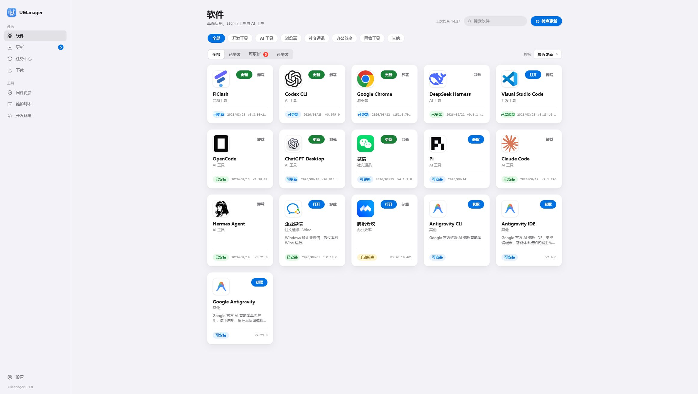

<p align="center"></p>

# UManager

**让 Ubuntu 的软件管理，简单一点。**

UManager 是面向 Ubuntu 的软件与开发环境管家。集中管理桌面应用、Node.js / Rust 工具链与 AI 编程 CLI，把安装、更新、卸载、下载进度和操作结果放在一个清楚的界面里。

[官网与下载](https://umanager.devtrends.site/) · [GitHub Releases](https://github.com/null-object-0000/umanager/releases) · [使用指南](docs/USER_GUIDE.md) · [反馈问题](https://github.com/null-object-0000/umanager/issues)



*实际前端的开发预览，版本、软件状态与数据仅作界面示意。*

## 安装

当前发布面向 **Ubuntu 22.04 及以上 · amd64（x86_64）**。普通用户无需克隆源码，也不需要安装 Node.js 或 Rust。

1. 前往 [官网下载页](https://umanager.devtrends.site/#download)，下载最新的 `UManager_<版本>_amd64.deb`；大陆用户可使用 EdgeOne 镜像，[GitHub Releases](https://github.com/null-object-0000/umanager/releases/latest) 保留备用。
2. 在安装包所在目录运行（将文件名替换为实际下载的版本）：

   ```bash
   sudo apt install ./UManager_<版本>_amd64.deb
   ```

3. 从应用菜单打开 **UManager**，或在终端运行 `umanager`。

APT 会自动补装 WebKitGTK、GTK 等运行时依赖。已安装用户可在「软件 / 更新」检查并安装 UManager 新版；卸载可在「设置」操作，或执行 `sudo apt remove u-manager`。

## 主要能力

| 场景 | 可以做什么 |
| --- | --- |
| 桌面软件 | 识别已安装的受管应用，从厂商官网 / 官方仓库安装、更新与卸载；打开本地 `.deb` |
| 下载与批量更新 | 后台队列可排队、可取消，支持批量更新受管 `.deb`；任务中心查看进度、确认清单与结果 |
| 开发环境 | 管理 nvm / Node.js、rustup / Rust，查看各 Node 版本独立的全局 npm 包 |
| AI 与 CLI 工具 | 管理 Claude Code、Codex CLI、OpenCode 等 AI 编程工具，以及 uv、pnpm 等开发 CLI |
| Windows 应用 | 在独立 Wine 环境管理企业微信 Windows 版；安装与兼容性边界见使用指南 |
| 归档应用与固件 | 部分官网 tar.gz 应用安装到用户目录；通过系统 fwupd 检查和更新支持的设备固件 |

受管软件包括 VS Code、Chrome、微信、QQ、飞书、WPS、Apifox、LocalSend 等，具体支持范围与可用版本以客户端及签名数据源为准。它并非整个 APT 软件库的替代品，各类软件的安装方式和支持边界见 [使用指南](docs/USER_GUIDE.md)。

## 每次操作，看清再确认

1. **先下载与校验**：核对 HTTPS 与允许域名、实际大小、SHA256，以及 `.deb` 的包名、版本和架构。
2. **再授权复核**：系统级操作经 Polkit 专用 helper，创建不可变计划并执行 dry-run。
3. **最后确认执行**：核对清单后再次确认。批量安装串行进行，失败时停止后续项目，不自动回滚已经完成的安装。

软件信息只来自 **Ed25519 签名 feed**，不在客户端临时抓取官网。下载不需要管理员权限；系统级安装、卸载等动作才进入授权流程。默认卸载保留个人数据，可选彻底清理必须先预览并确认清单。

自 v0.18.4 起，更新数据与图标优先使用 EdgeOne 全球镜像（含中国大陆）；自 v0.18.5 起，UManager 自身安装包也优先使用镜像。网络或完整校验失败自动回退 GitHub，取消下载会停止回退。**受管软件继续使用各自官方来源**；镜像不改变公钥、签名、下载计划或校验。详见 [镜像设计说明](DESIGN-feed-mirror.md)。

## 文档与贡献

- [使用指南](docs/USER_GUIDE.md)：批量更新、任务中心、彻底清理、Wine、固件与归档应用。
- [开发指南](docs/DEVELOPMENT.md)：环境准备、开发、测试与构建。
- [架构说明](ARCHITECTURE.md)：数据流、安全模型、签名 feed 与扩展应用。
- [协作约定](AGENTS.md)：贡献者与 AI 编程 agent 的开发指引。
- [发布记录](https://github.com/null-object-0000/umanager/releases)：版本、安装包与更新说明。

技术栈：**Tauri 2 · Rust · React · TypeScript**。欢迎通过 [Issues](https://github.com/null-object-0000/umanager/issues) 报告问题或讨论需求，通过 Pull Request 贡献改进。

## DevTrends 开发者工具

UManager 属于 DevTrends 开发者产品系列：

- [DevTrends](https://devtrends.site/)：发现全球开发者的新项目、新工具与新趋势。
- [模型价格 · models-cn](https://models.devtrends.site/)：比较中国大模型官方 API 定价与能力，保留来源与更新信息。
- [UManager](https://umanager.devtrends.site/)：管理 Ubuntu 软件、开发环境与 AI CLI。

由 [Super Newbie](https://www.snewbie.site/) 维护。
